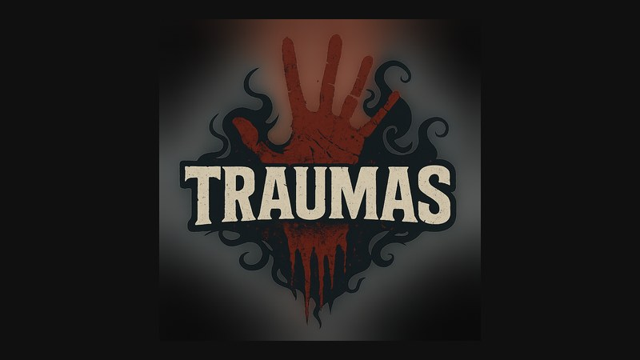
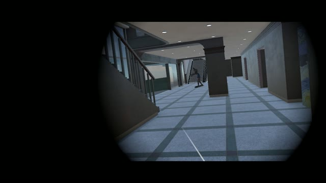
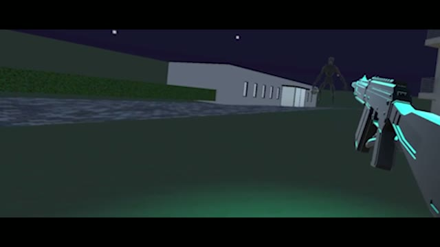
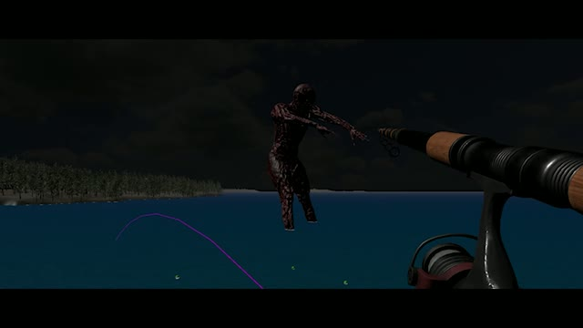
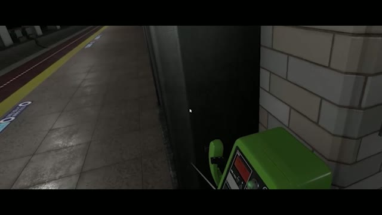

<p align="center"></p>

# Traumas VR

> 네 개의 공포 스테이지를 이어 통과하는 VR 게임
> 아주대학교 Immersive Media Programming(2025-1) VR 프로젝트 · 4인 팀 · 2025.04 – 2025.06

## ▶ 플레이 영상

https://github.com/user-attachments/assets/c611b497-d839-4bb8-9656-b249ef2780a2

<p align="center">트레일러 · 1분 44초</p>

## 한 줄 소개

잠든 주인공의 오프닝으로 시작해 서로 다른 네 개의 공포 스테이지를 차례로 통과하는 VR 게임입니다. 팀원 네 명이 스테이지를 하나씩 맡아 만들고, 오프닝부터 엔딩까지 하나의 빌드로 이었습니다.

| 영화관 복도와 좀비 | 총으로 괴물 막기 | 물속의 괴물 | 공중전화 |
|---|---|---|---|
|  |  |  |  |

## 게임 흐름

```
오프닝 → Stage 1 → Stage 2 → Stage 3 → Stage 4 → 엔딩
         영화관      (팀원)     (팀원)     (팀원)
         퍼즐·좀비   게임오버·클리어 화면 포함
```

## Stage 1 · 영화관 (내 스테이지)

- **소켓 퍼즐:** 퍼즐 조각 세 개를 각각 맞는 XR 소켓에 끼우면 다음 단계 오브젝트가 나타납니다.
- **레버:** 레버를 일정 각도 이상 당기면 다음 장면으로 넘어갑니다.
- **좀비 추적:** 플레이어가 가까이 오면 좀비가 NavMesh로 쫓아오고, 잡히면 스테이지가 처음부터 다시 시작됩니다.
- **발소리:** 플레이어가 움직이는 동안만 발소리가 반복됩니다.

## 팀과 역할

| 파트 | 담당 |
|---|---|
| **Stage 1 영화관, 전체 스테이지 연결, 오프닝·엔딩** | **송재혁** |
| Stage 2 · Stage 3 · Stage 4, 게임오버·클리어 화면 | 팀원 3명 |

### 내가 맡은 일 (송재혁)

- Stage 1 영화관의 소켓 퍼즐, 레버 씬 전환, NavMesh 좀비 추적과 리셋, 이동 발소리
- 팀원 네 명의 스테이지를 하나의 빌드 순서로 연결하고 오프닝·엔딩 씬 추가

`src/`는 Stage 1에서 제가 작성한 스크립트입니다.

| 스크립트 | 내용 |
|---|---|
| `PuzzleActivatorOnSocketEvent.cs` | 소켓 세 개가 모두 채워지면 퍼즐 완료 처리 |
| `LeverLoadScene.cs` | 레버 각도가 40°를 넘으면 다음 씬 로드 |
| `ZombieChase.cs` | 10m 안에 들어오면 NavMeshAgent로 추적 |
| `ZombieSceneReset.cs` | 좀비에게 잡히면 현재 씬 다시 시작 |
| `FootstepPlayer.cs` | 이동 중에만 발소리 반복 |

## 기술 스택

Unity 6 · C# · XR Interaction Toolkit (소켓·레버·이동) · NavMesh

## 이 저장소에 대해

소개용 저장소입니다. 팀 프로젝트 전체는 팀원 계정 저장소에 있고, 여기에는 게임 소개와 트레일러, 제가 작성한 스크립트만 담았습니다.
